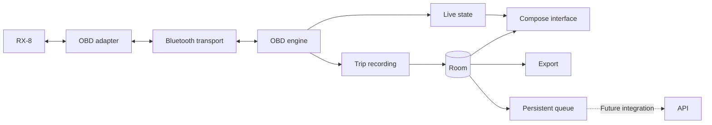

# Architecture

## Status

Version 0.12.0-dev implements automatic real-car sessions, a broader verified standard scalar catalog and a real RPM dial. It retains paged history, vehicle filtering, offline charts/exports, capability snapshots, explicit vehicle identity and disabled API preparation. Production navigation has four tabs; synthetic telemetry is confined to development fixtures.

The visible app attempts a privately saved successful Classic adapter once per process when permission and Bluetooth are available. A connected socket continues directly into ELM initialization and a journey for the selected persisted vehicle. Socket success remains distinct from ECU communication. Connection/acquisition/recording continue across tabs, background and lock through the foreground service.

The reference hardware is the European 2004 RX-8, 231 PS, Samsung A53 on Android 16 and iLC B0BDRHRR22. The user reported working Bluetooth, live readings over ISO 15765-CAN (11 bit, 500 kbaud), and broad success of earlier increments through 0.10.0-dev. Those reports do not establish new sensor support, individual lifecycle scenarios or measured rates/battery behavior. New phone validation is deferred.

The diagram includes future API integration. Local storage, pending work and isolated synchronization logic exist; no HTTP transport, upload worker, server or remote database is enabled. No GPS is collected.

## Components

Use Kotlin and Jetpack Compose for the interface, ViewModel/StateFlow for its state, and coroutines for asynchronous work.
Room stores vehicle profiles, active selection, trips, samples, and synchronization preparation; dashboard favorites use private SharedPreferences. Broader settings and real uploads remain future work.
Components can start as packages; there is no need to create a Gradle module for each component from day one.

## Transport and OBD engine

### Current discovery and transport

The Android transport lists paired devices and performs user-started bounded Classic discovery, merging by address without name filtering. Discovery stops on connection or when Adapter is hidden. Secure RFCOMM uses the Serial Port Profile UUID; Android handles pairing. BLE and unverified socket fallbacks are not implemented.

Connection attempts allow 15 seconds for bonded devices or 45 seconds for pairing. Discovery allows 15 seconds after up to two seconds stopping another inquiry. Byte operations are bounded and cancellable; closing the socket cancels blocked operations.

The service privately stores the last successful adapter. The process-level automatic policy allows one visible-app attempt when connection permission and Bluetooth are available. Manual connection and explicit disconnection consume that opportunity; failures do not loop. Tab switches, recreation and document results do not start a new session. A new process may attempt a fresh connection; it never restores a killed service/session.

The non-exported connectedDevice service is promoted while the app is visible, before connecting. Its controller runs an authorized continuation after the socket opens: freeze connection time, prepare automatic recording, then initialize OBD. Generation/cancellation checks prevent late connections or profile loads from starting obsolete work. This continuation can finish after the app backgrounds without treating it as a new background connection.

A socket does not prove ECU compatibility. Manual retry remains available in Adapter. Android guidance: [RFCOMM clients](https://developer.android.com/develop/connectivity/bluetooth/connect-bluetooth-devices), [foreground-service start restrictions](https://developer.android.com/develop/background-work/services/fgs/restrictions-bg-start), and [connected-device service requirements](https://developer.android.com/develop/background-work/services/fgs/service-types#connected-device).

### Current read-only OBD engine

RX8-004 separates pure parsing in `:core:telemetry` from the session scheduler in `:app`:

- Reset and configure the ELM interface, use automatic vehicle-protocol selection, and read the detected protocol. Configuration replies must be valid before acquisition continues.
- Assemble Bluetooth byte fragments into complete prompt-terminated replies. A single serialized exchange owns the connection; bounded buffers and whole-command deadlines prevent a slow or broken adapter from hanging indefinitely.
- Close the link after a missing prompt or transport failure so a late reply cannot be treated as the answer to a new command. Retry only complete, recoverable replies within a bounded policy.
- Read Mode 01 supported-PID bitmaps and retain each ECU's capabilities. Request only implemented scalar PIDs reported by at least one responding ECU. One PID can yield multiple independently identified scalar components.
- Parse CAN 11/29-bit single-frame and supported legacy header formats, keeping ECU source identifiers. Unexpected layouts, wrong PIDs, and malformed data fail visibly rather than being interpreted as values.
- Schedule RPM and speed more often than slower parameters, with serial requests and latency/error backoff. Report the observed response rate without promising a fixed sampling frequency.
- Preserve timestamps and units, distinguish missing/unsupported/error results, and mark old valid values stale. Explicit disconnection or a terminal error cancels acquisition and marks retained values stale. Leaving Adapter keeps an active session running.

The expanded catalog contains 120 scalar fields from 84 sensor PIDs through hexadecimal PID64, plus two scaling metadata PIDs (4F/50). It covers verified scalar sensor/counter fields, including oxygen-sensor components, fuel trims, pressures, airflow, timing, temperatures and counters. Bitfields, enumerated status and unverified/proprietary PIDs remain advertised without invented scalar decoders.
Capability blocks are discovered separately from decoding; a reported PID is not a promise that this build displays that parameter.
Mode 01 replies fit a single CAN data frame. VIN reconstruction is separately limited to the Mode 09 layouts below; neither path implements general ISO-TP or arbitrary multi-frame diagnostics.
The live panel displays separate ECU groups when several modules respond; it does not silently combine their values or identify an ECU as the engine controller based only on its address.
The engine uses read-only diagnostic requests and adapter configuration. It sends no fault-clearing, actuator, or ECU programming commands.

Do not commit to a per-sensor sampling rate before measuring it. Sequential readings are not simultaneous: each has its own timestamp.
The adapter's identification string alone does not prove its authenticity or all of its capabilities.
Command and response layouts follow the [ELM327 data sheet](https://www.elmelectronics.com/wp-content/uploads/2016/07/ELM327DS.pdf). Adapter clones and the actual RX-8 still require hardware testing.

The catalog includes the original six channels; four primary and four secondary fuel-trim PIDs with optional extra bank fields; fuel/manifold/rail/evaporative/barometric pressures; ignition/injection timing; mass airflow; engine run time, distance and MIL counters; EGR/purge/fuel/alcohol/load/throttle/accelerator values; voltage, temperatures, fuel rate and torque; and separate voltage/ratio/current/trim channels for O2 slots. Slot labels do not guess the bank topology. An unavailable optional component remains null, not a fabricated sensor.

Definitions follow the SAE-authored [J1979-DA October 2011 tables](https://f30.bimmerpost.com/forums/attachment.php?attachmentid=1800282&d=1523076762), reproduced by a third party, and the [ELM327 data sheet](https://www.elmelectronics.com/wp-content/uploads/2016/07/ELM327DS.pdf). The catalog is a software decoder list, not evidence that this RX-8 has oil-temperature, fuel-rate, torque or every O2 sensor. Bitfields, enumerated status, DTCs and later compound/proprietary PIDs are not presented as decoded scalar readings.

Advertised scaling metadata 4F/50 is read per ECU before dependent fields. If that advertised metadata fails, affected fields remain unavailable instead of silently using default scaling. A single request can produce multiple metrics with one timestamp. Polling fairly interleaves RPM/speed, the original slower sensors, added sensors and slow counters. Freshness limits are 5/15/120/180 seconds by group, not promised sampling frequencies; real adapter rates must be measured. Capability snapshots still describe displayed state rather than cumulative outcomes.

### Optional VIN acquisition

The user chooses Read VIN only after the OBD session reaches LIVE. The request is queued between complete sensor exchanges; it does not run automatically on Bluetooth connection, profile selection, or live-data startup.
For CAN, the session first enables automatic adapter flow control with `ATCFC1`, then requests `0902`. Sensor polling resumes after the bounded VIN request.
The pure VIN parser supports CAN 11/29-bit identifiers with the 20-byte Mode 09 response (`49 02 01` plus 17 VIN characters), and five ordered legacy packets with three leading zero filler bytes.
It checks per-ECU completeness, sequence, service/PID, and VIN structure. Conflicting, partial, or malformed sequences fail the complete reply; no partial VIN becomes a candidate. Headerless, extended-address, long KWP, and general ISO-TP layouts are not inferred.
The adapter validates legacy checksums/CRCs; printed error markers are rejected. This software support does not establish that the actual adapter/car supplies a VIN.

A complete prompt containing NO DATA, an unsupported request, or malformed VIN data reports a VIN-specific result while Mode 01 polling continues. A transport timeout, missing prompt, or unsafe framing closes the link and requires manual reconnection.
Multiple valid ECU candidates remain separate. Candidates are masked, held in memory, and cleared with the session. Choosing one explicitly copies it into Vehicles for review before any database write.

## Capability snapshot reports

RX8-010 maps an existing completed-discovery `ObdSessionSnapshot` into a dedicated immutable report only after an explicit capture action. It does not subscribe to an acquisition event stream, add requests, or count outcomes from a conflated UI flow. The report describes latest displayed state; initial no-data, ticker, and stale transitions are not represented as completed requests.

`CapabilityReports` bounds and validates the input, copies nested collections, recognizes protocols/ECU addresses, and retains only the approved fields. `CapabilityReportJson` encodes a separate bounded schema version 1. No serializer receives the whole Bluetooth state, VIN snapshot, adapter identity, free-form status/error text, or profile/trip metadata.

The Activity-scoped `CapabilityReportViewModel` owns the captured preview and pending immutable JSON. A root-level `CreateDocument` registration remains active across navigation/recreation. A pending export refuses another capture or picker until it is resolved. IO runs outside the UI thread; success follows write/flush/close, while process loss or failed providers produce generic errors without exporting a substitute report. Returning from a picker does not reconnect, query, or start recording.

Capabilities remains a child of Adapter, with explicit Back and Capture latest snapshot controls. It does not own a screen-awake flag. Retained stopped/error snapshots stay labeled historical; the preview remains frozen even if live acquisition continues. No Room/schema, trip-export contract, or synchronization change is involved. See [Capability reports](capability-report.md).

## Current dashboard and preferences

The Live dashboard consumes service snapshots without owning a socket or another polling loop. Its per-ECU RPM dial uses real quality/value/age, and the displayed scale does not claim an engine limit. Speed/coolant stay primary; supported extra scalar sensors are selectable favorites. Stopped/error values remain historical, missing values remain absent, and valid zero/negative values survive formatting.

Four single-line tabs replace the previous five-tab layout. Larger labels can scroll horizontally. Restored Simulator or unknown routes resolve to Live; production no longer instantiates the Simulator ViewModel. Internal labelled fixtures retain synthetic scenarios for tests only.

Private app-wide `dashboard_preferences` stores stable `favorite_metric_ids_v1`, independent of profile or ECU identity. Existing IDs remain valid. Fixed primary metrics cannot become favorites; unknown IDs are ignored, unavailable saved choices remain removable. Favorites never change acquisition or recording coverage. Serialized commits publish success only after saving, with loading/error states. No readings are stored in these preferences.

## Local model

| Entity | Contents |
| --- | --- |
| Vehicle | Stable UUID, optional VIN, provenance, and alias |
| Adapter | Connection information and observed capabilities |
| Capability | Parameters by vehicle, ECU, and profile |
| Session | Start, end, duration, status, and real/simulated origin |
| TelemetrySample | UUID, sequence, timestamps, metric, value, unit, source, and status |
| OutboxEntry | Pending work, attempts, next execution, and acknowledgments |

Vehicle, active selection, Session, TelemetrySample, and pending work are persisted; dashboard preferences and the last successful adapter are stored separately. Capabilities remain in memory; the detected protocol is copied into the current trip after discovery. Profile changes never reassign previously stored telemetry.

Recorded samples are immutable. Sessions use the recording, completed, or interrupted states.
Each reading carries a UTC timestamp and monotonic elapsed time since the start; sequence determines ordering.
Values are normalized to canonical units and converted only for display.

A failed reading has a null value. The interface may show the last valid reading as stale without storing it again as a new measurement.
Estimated distance integrates only adjacent valid speed samples from one selected ECU; uncovered intervals remain gaps.

## Identity and current persistence

A profile is created only after an explicit user action. The repository generates one UUID, stores its alias and creation timestamp, and selects it in the same Room transaction.
Aliases are trimmed, contain 1-60 characters, and reject control characters. Rename changes only the alias.
A VIN is optional. Manual input trims surrounding whitespace and uppercases ASCII characters, requiring 17 letters/numbers excluding I, O, and Q. This is structural validation; it does not infer region/model/year, impose a regional check digit, or prove ownership.
Saved provenance is MANUAL or OBD; OBD provenance includes the ECU source. Attaching the same VIN preserves original provenance; adding a VIN to a VIN-less profile preserves the UUID.

The Vehicles screen shows saved profiles, selected state, permanent IDs, and masked VINs with explicit show/hide controls.
A duplicate VIN points to its existing profile and requires explicit selection. A different VIN cannot overwrite a profile: the user must select the corresponding vehicle or create a separate one. No automatic profile assignment or merging is implemented.
The adapter MAC address never identifies a vehicle. Starting a trip freezes the selected profile's UUID and alias. Later profile selection or renaming does not relabel that trip or its samples.

Room schema version 3 retains `vehicle_profiles`, `active_vehicle`, `trip_sessions`, and `trip_samples`; it adds metadata revisions, nullable recording app version, `sync_work`, and `sync_samples`. Explicit migrations from 1 to 2 and 2 to 3 preserve profiles, selection, trips, and samples. The 2-to-3 migration inserts pending references for existing samples through SQLite rather than loading all telemetry into memory; metadata is encoded one cursor row at a time. It never marks old data delivered or invents its original app version. VIN uniqueness and foreign keys protect the relationships; a unique trip/sequence index prevents duplicate sample positions.
Room schema version 4 adds only the history indexes `(startedAtEpochMillis, id)` and `(vehicleId, startedAtEpochMillis, id)` through an explicit 3-to-4 migration. The existing migration chain is retained; no profiles, selection, trip/sample data, metadata revisions, or queue state are rewritten by this upgrade.
The application-scoped `rx8-vehicles.db` lives in private app storage. A failed read or write reports an error rather than replacing profiles with a new empty database. There is no destructive migration fallback; future changes require explicit migrations and schema review.
Only successful storage results reach the UI as saved. Trip deletion and JSON/CSV export are implemented; profile deletion, importing, and restoring an app database are not.
Android backups and device transfer are excluded. Clearing app data or reinstalling removes saved profiles and trips. An exported trip can be inspected separately, but cannot currently restore the app's database or vehicle profiles.

## Sessions and permissions

### Current connection permissions

On Android 12/API 31 and later, connecting requires `BLUETOOTH_CONNECT`, and discovery also requires `BLUETOOTH_SCAN`, through Nearby devices runtime prompts.
Scan access uses `neverForLocation`; the app does not derive physical location from scan results.
On API 26-30, legacy `BLUETOOTH` and `BLUETOOTH_ADMIN` apply, and discovery requires foreground fine-location permission and enabled location services.
Those legacy permissions are limited to API 30. Android 12+ does not request location permission. No GPS collection, advertising, or Internet permission is implemented.
Android can present pairing during connection. Bluetooth and permission settings remain available for recovery.
See Android's [Bluetooth permission guidance](https://developer.android.com/develop/connectivity/bluetooth/bt-permissions).

### Current background session lifecycle

The started and bound connected-device foreground service owns controller jobs, Bluetooth events and acquisition. MainActivity reports visible-app eligibility separately from Adapter discovery visibility. Automatic/manual connection promotion happens while visible; the already authorized initialization can continue after tab changes/background/lock/recreation. Read VIN remains explicit.

The ongoing notification offers Stop/open-Adapter without VIN, MAC, UUID or readings. On API 33+, notification access is requested through the visible UI; denial does not block the session. Discovery stops when Adapter is hidden. Adapter/Live hold the screen-on flag only during visible real initialization/discovery/live acquisition. Acquisition uses a bounded 120-second partial wake lock renewed every 60 seconds and released on stop/error/cleanup.

Stop/disconnect releases sockets/jobs but retains foreground ownership until final recording writes settle. The service uses START_NOT_STICKY, no background reconnect loop and no process-death session restoration. The app never removes a Bluetooth bond. Battery use and sustained A53 behavior still require measurements; no battery-optimization exemption is requested.

### Current trip recording

At socket connection the service captures UTC and monotonic time, then reads the persisted selected vehicle with a bounded lookup. It waits for any preceding trip's final write before starting the next recorder. The selected UUID/name are frozen. The recorder starts at the connection anchor before the first OBD callback, so initialization time is represented without inventing samples. If selection is missing or fails, reading continues with visible guidance; selecting a vehicle later starts from then, without backfilling earlier readings/time.

`TripRuntime` owns the process-scoped ordered writer, independent of UI collectors and service binding. Controller callbacks feed it directly. Initial placeholder readings carry `isRequestResult = false` and are excluded; the first actual valid/error result is retained. Cached, STALE and UNSUPPORTED display states are not resaved. Each sample preserves UUID, sequence, UTC, monotonic elapsed time, metric, canonical unit, ECU and quality; failed values remain null.

The command channel serializes create, discovered-protocol update, samples and finish. Pending samples are bounded at 512; overload interrupts visibly. Start/count/finish success reflects durable commits. At least 10 MiB is checked before create/append; storage failure stops recording and attempts an interrupted marker, with startup recovery handling an uncommitted marker.

Automatic start initially has no detected protocol. Its first known protocol is committed once in a new session metadata revision with an immutable outbox body. Earlier prepared revisions are unchanged; the established protocol cannot be reassigned. No schema change is required. Finish/recovery creates the next revision.

Stop recording completes the trip while acquisition continues and suppresses automatic restart for that connection. Explicit manual start can resume as a separate journey. Disconnect/notification Stop completes; loss/OBD failure interrupts. A fresh connection creates a new journey and never joins across the gap. Startup marks unfinished rows interrupted using the last saved reading or the start of an empty trip, not a guessed termination time. It never appends to the old trip.

Journeys contain telemetry only, without GPS. WorkManager remains reserved for future synchronization.

### Trip summaries and charts

History retains one page of at most 50 sessions and the app database footprint, including profiles and trips. The page query never loads samples. Complete summaries, exports, and deletion require a completed or interrupted trip, keeping sample reads independent of an actively growing recording.

RX8-014 orders history by `(startedAtEpochMillis DESC, id DESC)`. A cursor contains both immutable values, so equal timestamps and deletion of the cursor row do not lose the boundary. Separate filtered/unfiltered indexed queries support newest, older, newer, and inclusive at-or-older requests; newer queries reverse only the bounded returned page. Indexed existence probes compute both navigation flags in a short read transaction. There is no OFFSET, full-history count, accumulated page cache, or long-lived database snapshot.

Filtering uses the permanent vehicle UUID from existing profiles and does not mutate profile selection, recording, or pending work. Current names label filter choices; saved aliases label trips. The Activity-owned ViewModel keeps the filter, confirmed page, refresh anchor, and request generation. Cancellation plus identity/generation checks reject obsolete successes and failures, including repeated A-to-B-to-A changes. Same-filter errors preserve correctly labelled rows; changing filters clears rows from the previous filter. Storage and queue errors stay independent of history errors. Lifecycle refresh retains the current anchor, while Newest explicitly resets it. Successful deletion refills the page, with a bounded newest-page fallback if it becomes empty. Navigation/deletion must invalidate earlier requests. Activity recreation retains browsing state; process-death restoration is not promised.

Analysis reads sequence-ordered pages of at most 500 samples. It selects the lexicographically first speed ECU with usable valid km/h data, falling back to the first observed speed ECU if none has usable values. Speed maxima, the chart, and distance all use that one source; different ECU readings are never averaged or joined. Peak recorded RPM considers finite, valid canonical RPM readings across sources.

Estimated distance uses trapezoidal integration between adjacent valid, nonnegative speed samples from the selected source only when the monotonic interval is positive and at most five seconds. Missing/invalid readings, wrong units, reversed timestamps, and longer intervals break coverage. There is no endpoint extrapolation. An estimate requires at least one covered interval; valid stationary intervals can produce a true zero. The UI labels the result as an estimate, identifies the source, and shows covered and uncovered duration; it is not an odometer reading.

RX8-012 collects recorded metric/ECU options during the first summary pass, including error-only sources. The index is bounded to 3,840 combinations (120 metrics across at most 32 ECU sources) and fails explicitly above that limit. Selection defaults to the overview's speed ECU, then stable metric/ECU order. It never depends on current live capabilities, selected profile, or favorites.

Each selected series reads pages of at most 500 samples and retains at most 500 chart points. Counts, observed min/max, and coverage use the original selected stream before reduction. A usable value needs VALID quality, the canonical unit, a finite value within the existing decoder domain, and an in-range, strictly increasing elapsed timestamp. Zero and signed values are valid when inside each metric domain; temperature ranges depend on the sensor. Failed/stale/wrong-unit/out-of-range samples, duplicate/reversed timestamps, and intervals beyond the selected metric gap limit break the line and coverage. Original six metrics retain five seconds; added metrics use their polling-class freshness limit. No endpoint extrapolation or joining across ECU sources is allowed. Streaming reduction preserves null gap barriers; it may omit chart detail but cannot change full-stream statistics. The existing overview speed chart model and distance calculation retain their semantics.

The Activity-owned Trips ViewModel loads summaries and selected series separately. Selection cancels previous chart work and advances a generation token; trip changes, closing details, and successful deletion invalidate outstanding work. Both generation and selected identity must match before accepting a result, including A-to-B-to-A changes and reopening the same trip. Chart errors retain the trip overview and offer a chart-only retry. Activity recreation retains selection; process-death restoration is not promised. Analysis and export support coroutine cancellation and reject broken page ordering or foreign-trip samples. History navigation does not change chart analysis, export v1, acquisition, or API preparation.

## Current API preparation

RX8-008 introduces pure Kotlin versioned wire models, explicit field/unit/quality mapping, a transport interface, a disabled transport, an isolated coordinator, and a durable Room store. No HTTP client or fake server is packaged in the app. `TripRuntime` exposes a production `RoomSyncStore` only for the Trips status query; it does not create or schedule a coordinator.

`RoomTripRepository.append` inserts immutable samples and pending sample references in the same transaction. Vehicle create/rename/VIN attachment and trip start/protocol-discovery/finish/recovery create immutable metadata snapshots in their source transaction. Selection alone is not a metadata revision. A recording session has null wire end/duration; finish/recovery increments its revision so an old retry cannot reopen it. New recordings snapshot their app version. Legacy versions and unconfirmed make/model/year/market/power remain null.

`sync_samples` references original samples instead of duplicating the history. `sync_work` retains immutable JSON for metadata revisions and prepared batches, attempts, retry time, lease identity/expiry, state, and a bounded diagnostic code. Requests are claimed transactionally in vehicle/session/sample dependency order. Batches use configurable sample and UTF-8 byte bounds. A lost response reuses the exact saved payload and identity; partial ACKs or splitting create new batches without editing previously attempted bodies.

An entire response must match its request before any acknowledgment is committed. Only explicit stored/already_stored sample results acknowledge delivery. Rejected samples are blocked; omitted samples remain pending. Expired leases can be reclaimed, and stale or deleted work cannot be acknowledged by a late response. Conflicts/permanent failures preserve local data. The coordinator applies bounded retry delays and supports Retry-After; future HTTP parsing/authentication remains outside this increment.

The disabled transport and the coordinator's non-isolated-store guard return before claiming or mutating work. Fake-server exercises use isolated fixtures only, including persistence/restart tests. There is no Internet permission, endpoint, credential, WorkManager job, upload switch, or route by which these tests mark production samples uploaded.

Trips queries sample-state totals independently of history loading and labels uploads disabled. The count is a last-refresh snapshot, not a per-reading database subscription. Query errors remain explicit without changing the history or manufacturing zero counts. See [the contract](api-contract.md) for wire fields, states, limits, and the future integration boundary.

## Retention and export

Trips remain stored until explicitly deleted. Deletion requires confirmation and removes that trip, its samples, and related pending/prepared work in a transaction; it does not delete vehicle profiles or previously exported files. Database space may be retained for reuse rather than immediately shrinking the file. Local deletion is not a request to a future server.

The user chooses a JSON or CSV destination through Android's document picker, without a broad storage permission or automatic upload. Exports stream sequence-ordered pages instead of materializing the full history. Success is reported only after writing, flushing, and closing the destination; a failed or cancelled write may leave a partial file and is not reported as saved.

Local export schema version 1 includes trip/vehicle/sample IDs, the recorded vehicle alias, timestamps, monotonic times, protocol, origin, terminal status/reason, units, ECU sources, and sample quality. It contains no VIN or Bluetooth address. JSON preserves null values and escaped text; CSV repeats trip metadata on each sample row and writes a metadata-only row for an empty trip. CSV text beginning with spreadsheet formula triggers receives a protective apostrophe. Non-finite numeric values cause export failure instead of invalid output or replacement zeros. See [the local export contract](api-contract.md#implemented-local-trip-export) for fields and its boundary with the future API.

Exports contain private trip information and are shared only through the user's chosen destination. Do not commit real databases or private exports. Android backup/device transfer remain disabled, and importing or restoring exports is not implemented.

## Validation

Parser tests cover complete, fragmented, multi-ECU, and malformed Mode 01/VIN responses. Identity tests cover duplicate/different VINs, UUID/provenance preservation, explicit selection, storage failures, and reopening Room. Actual run results belong in the PR.
Tests for persistence, migrations, identity, unexpected termination, the queue, and retries.
Interface checks cover the real live dashboard with clearly labelled synthetic test fixtures, per-ECU capabilities, stale/error/zero states, unavailable favorites, and preference persistence/failure. Actual run results belong in the PR.
Lifecycle checks cover Activity recreation, continued background samples, notification denial/Stop, and resource release. Trip checks cover ordered durable recording, bounded backpressure, storage failures, migration/recovery, vehicle identity freezing, source-isolated analytics, chart gaps, cancellation, export escaping, and deletion. Actual test results belong in the PR. Real-vehicle validation still needs compatibility, measured rates, battery use, and saved recording with the A53 screen locked.

## References

- [Android architecture](https://developer.android.com/topic/architecture/recommendations).
- [Bluetooth Classic](https://developer.android.com/develop/connectivity/bluetooth/connect-bluetooth-devices).
- [Bluetooth permissions](https://developer.android.com/develop/connectivity/bluetooth/bt-permissions).
- [Connected-device foreground services](https://developer.android.com/develop/background-work/services/fgs/service-types#connected-device).
- [Notification permission](https://developer.android.com/develop/ui/compose/notifications/notification-permission).
- [Keeping the screen on](https://developer.android.com/develop/background-work/background-tasks/awake/screen-on).
- [Wake locks](https://developer.android.com/develop/background-work/background-tasks/awake/wakelock).
- [Offline-first operation](https://developer.android.com/topic/architecture/data-layer/offline-first).
