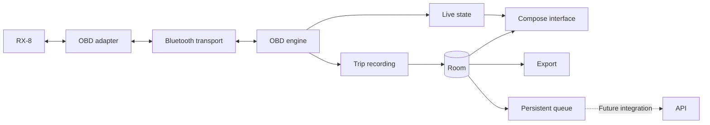

# Architecture

## Status

The initial Android foundation contains a Compose `:app` module and a pure Kotlin `:core:telemetry` module.
Its deterministic simulator supports normal operation, timeouts, and missing data, with connect, disconnect, and reset controls.
Sampling pauses while the app is in the background; no foreground recording service is implemented yet.

The remaining sections describe the **target MVP architecture**.
Bluetooth transport, actual OBD queries, persistent vehicle identity, saved trips, Room/DataStore storage, and API synchronization remain planned.
The simulator is not evidence of real-car compatibility, and installation on the Samsung A53 remains pending under RX8-002.
See [Development](development.md) for setup, commands, and the current validation boundary.

Target: European-market 2004 RX-8 with 231 PS, Samsung A53, and iLC B0BDRHRR22 adapter.
Exact compatibility will be confirmed in RX8-001.

## Components

Use Kotlin and Jetpack Compose for the interface, ViewModel/StateFlow for its state, and coroutines for asynchronous work.
Room stores structured data; DataStore stores settings.
Components can start as packages; there is no need to create a Gradle module for each component from day one.

## Transport and OBD engine

Bluetooth Classic RFCOMM/SPP is the initial assumption for this adapter; validate it before committing to that transport.
BLE requires a different implementation. The transport interface exposes connections, bytes, and cancellation without interpreting sensor data.

The OBD engine:

- Initializes the adapter and discovers the protocol and capabilities.
- Serializes requests through a queue with timeouts and bounded retries.
- Reassembles fragments and preserves the source ECU when multiple modules respond.
- Distinguishes adapter errors, missing responses, and unsupported parameters.
- Prioritizes visible/selected sensors and adjusts polling intervals to latency.
- Avoids repeatedly querying parameters reported as unsupported.

Do not commit to a per-sensor sampling rate before measuring it. Sequential readings are not simultaneous: each has its own timestamp.
The adapter's identification string alone does not prove its authenticity or all of its capabilities.

## Local model

| Entity | Contents |
| --- | --- |
| Vehicle | Stable UUID, optional VIN, provenance, and alias |
| Adapter | Connection information and observed capabilities |
| Capability | Parameters by vehicle, ECU, and profile |
| Session | Start, end, duration, status, and real/simulated origin |
| TelemetrySample | UUID, sequence, timestamps, metric, value, unit, source, and status |
| OutboxEntry | Pending work, attempts, next execution, and acknowledgments |

Samples are immutable. Sessions use the recording, completed, or interrupted states.
Each reading carries a UTC timestamp and monotonic elapsed time since the start; sequence determines ordering.
Values are normalized to canonical units and converted only for display.

A failed reading has a null value. The interface may show the last valid reading as stale without storing it again as a new measurement.
Distance integrated from speed is identified as an estimate and records intervals with missing data.

## Identity

Always create a vehicleId UUID when registering a car.
The VIN is optional, retrieved through mode 09 PID 02 or entered manually, with validation and provenance.

Adding a VIN does not change the identity or split the history.
A different VIN must not be silently assigned to the active profile: the user must select or create the corresponding vehicle.
The adapter's MAC address does not identify the car. Without a VIN, the user selects the profile when necessary.

After clearing app data or reinstalling, recovering the same UUIDs requires restoring a compatible backup/export.
Import/restore has not been implemented and is not guaranteed in the MVP; JSON retains the necessary information.

## Sessions and permissions

A recording started by the user uses a connectedDevice foreground service with a notification and a stop action.
Request BLUETOOTH_CONNECT on Android 12+ and BLUETOOTH_SCAN when discovery is needed.
The service declares the permissions and type required by the Android version/target.
Handle requirements for older versions separately.

The MVP does not include GPS. WorkManager is reserved for future synchronization, not vehicle polling.

Recording with the screen locked will be tested on the A53. Indefinite survival after process termination is not promised.
Record a gap when Bluetooth is lost; after restarting, recover persisted data and mark the unfinished session as interrupted.

## Future synchronization

Define a remote interface, versioned models, and a fake implementation solely for isolated tests.
The app used with real data keeps uploads disabled until an API and authentication are available.

Local writes and pending-work creation are atomic.
The queue references persisted samples without duplicating the entire history.
A future worker sends batches, observes connectivity requirements, and confirms only records that receive an acknowledgment (ACK).
A server simulator must never mark the user's real data as uploaded.
See [the contract](api-contract.md) for details.

## Retention and export

Keep trips until explicitly deleted, show storage usage, and warn before storage runs out.
If data cannot be saved, stop recording in a controlled way and display the error.
When deleting records pending upload, explain which data will be lost and remove their queued work.

Export versioned JSON with IDs, units, and statuses; use CSV for analysis.
Do not commit real databases or private exports.
Define exclusions/encryption for Android backups before distribution.

## Validation

Parser tests with complete, fragmented, multi-ECU, and malformed responses.
Tests for persistence, migrations, identity, unexpected termination, the queue, and retries.
Interface tests with a clearly identified simulator.
Real-vehicle validation for compatibility, sampling rate, reconnection, and recording with the screen locked.

## References

- [Android architecture](https://developer.android.com/topic/architecture/recommendations).
- [Bluetooth Classic](https://developer.android.com/develop/connectivity/bluetooth/connect-bluetooth-devices).
- [Bluetooth permissions](https://developer.android.com/develop/connectivity/bluetooth/bt-permissions).
- [Foreground services](https://developer.android.com/develop/background-work/services/fgs/service-types#connected-device).
- [Offline-first operation](https://developer.android.com/topic/architecture/data-layer/offline-first).
