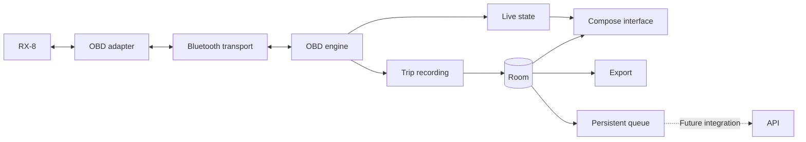

# Architecture

## Status

The 0.9.0-dev app adds an allowlisted capability snapshot/report to versioned API models, the local queue, offline trips, the live dashboard, simulator, service-owned OBD acquisition, optional VIN acquisition, and vehicle profiles. Real uploads remain disabled.
The Bluetooth screen combines paired devices and nearby discoveries, handles scan and connection permissions separately, and opens a secure RFCOMM socket.
Device names and MAC addresses are shown locally so the user can identify the OBDII adapter reported in Car Scanner.
The connection starts without OBD commands. An explicit Read live data action initializes the adapter and starts Mode 01 acquisition, keeping Bluetooth status separate from ECU communication.

An explicitly started real connection/acquisition session continues across tabs, backgrounding, screen lock, and Activity recreation. Discovery stops when Adapter is hidden; simulation pauses when Simulator is hidden. Saved profiles remain available without a connection.
The user reported the simulator app worked after testing on October 10, 2026 and confirmed the Samsung A53 runs Android 16.
The paired-only Bluetooth build failed to list the adapter, which the user finds by searching in Car Scanner with plain Bluetooth selected.
The user confirmed Bluetooth works and, on October 11, 2026, reported that live readings worked; PR #14 is merged. The user reported `ISO 15765-CAN (11 bit, 500 kbaud)` and later confirmed correct readings in 0.5.0-dev. These reports do not establish individual sensors, ECU identifiers, measured rates, sustained lifecycle behavior, VIN retrieval, or profile persistence. Detailed RX8-001/RX8-004 checks remain open.

The diagram includes the future API connection. Recording, local storage, outbox preparation, and an isolated synchronization coordinator are implemented; there is no HTTP transport, upload worker, server, or remote database.
The engine provides six Mode 01 decoders, capability discovery, and an explicit Mode 09 PID 02 VIN request. Room stores profiles, active selection, trips, samples, and pending work; SharedPreferences stores app-wide dashboard favorites. Broader settings and real API integration remain planned.
See [Development](development.md) for setup and current behavior.

Target: European-market 2004 RX-8 with 231 PS, Samsung A53 running Android 16, and iLC B0BDRHRR22 adapter.
Secure Classic/SPP has a successful user-reported connection. RX8-001 must establish actual ECU compatibility and sustained behavior.

## Components

Use Kotlin and Jetpack Compose for the interface, ViewModel/StateFlow for its state, and coroutines for asynchronous work.
Room stores vehicle profiles, active selection, trips, samples, and synchronization preparation; dashboard favorites use private SharedPreferences. Broader settings and real uploads remain future work.
Components can start as packages; there is no need to create a Gradle module for each component from day one.

## Transport and OBD engine

### Current discovery and transport

The Android transport is separate from Compose presentation and the synthetic telemetry source.
It lists bonded devices and performs a user-started, bounded Classic inquiry. Results are merged by MAC address, without filtering by adapter name.
Discovery stops before connecting, when cancelled, or when leaving the foreground. Scanning is unavailable during a connection.
It attempts secure RFCOMM using the standard Serial Port Profile service UUID; Android handles pairing when the selected device is not bonded.
It does not implement a BLE transport or fallback to an unverified connection method.

Connection attempts run away from the UI thread with a 15-second timeout for bonded devices or 45 seconds for unbonded devices to allow Android's pairing prompt.
Each discovery inquiry is limited to 15 seconds, after allowing up to two seconds to stop an existing inquiry.
Byte reads and writes are bounded and cancellable; closing the socket cancels blocked operations.
The OBD engine uses these operations only after the user selects Read live data. Connecting alone sends no application commands.
Android still performs the protocol handshakes needed to establish the Bluetooth connection.

A non-exported connectedDevice foreground service owns the session controller, socket, acquisition jobs, and Bluetooth-event receiver. The visible Connect action starts/promotes the service before connecting; Read live data starts OBD separately. While acquisition runs, command deadlines detect missing replies. There is no automatic reconnection.
The user reconnects manually, and a connected socket does not establish adapter command compatibility or sensor availability.
This follows Android's [paired-device](https://developer.android.com/develop/connectivity/bluetooth/find-bluetooth-devices) and [RFCOMM client](https://developer.android.com/develop/connectivity/bluetooth/connect-bluetooth-devices) guidance.

### Current read-only OBD engine

RX8-004 separates pure parsing in `:core:telemetry` from the session scheduler in `:app`:

- Reset and configure the ELM interface, use automatic vehicle-protocol selection, and read the detected protocol. Configuration replies must be valid before acquisition continues.
- Assemble Bluetooth byte fragments into complete prompt-terminated replies. A single serialized exchange owns the connection; bounded buffers and whole-command deadlines prevent a slow or broken adapter from hanging indefinitely.
- Close the link after a missing prompt or transport failure so a late reply cannot be treated as the answer to a new command. Retry only complete, recoverable replies within a bounded policy.
- Read Mode 01 supported-PID bitmaps and retain each ECU's capabilities. Request only the six implemented metrics reported by at least one responding ECU.
- Parse CAN 11/29-bit single-frame and supported legacy header formats, keeping ECU source identifiers. Unexpected layouts, wrong PIDs, and malformed data fail visibly rather than being interpreted as values.
- Schedule RPM and speed more often than slower parameters, with serial requests and latency/error backoff. Report the observed response rate without promising a fixed sampling frequency.
- Preserve timestamps and units, distinguish missing/unsupported/error results, and mark old valid values stale. Explicit disconnection or a terminal error cancels acquisition and marks retained values stale. Leaving Adapter keeps an active session running.

The first decoders cover PIDs `04`, `05`, `0C`, `0D`, `0F`, and `11`: load, coolant temperature, RPM, speed, intake temperature, and throttle position.
Capability blocks are discovered separately from decoding; a reported PID is not a promise that this build displays that parameter.
Mode 01 replies fit a single CAN data frame. VIN reconstruction is separately limited to the Mode 09 layouts below; neither path implements general ISO-TP or arbitrary multi-frame diagnostics.
The live panel displays separate ECU groups when several modules respond; it does not silently combine their values or identify an ECU as the engine controller based only on its address.
The engine uses read-only diagnostic requests and adapter configuration. It sends no fault-clearing, actuator, or ECU programming commands.

Do not commit to a per-sensor sampling rate before measuring it. Sequential readings are not simultaneous: each has its own timestamp.
The adapter's identification string alone does not prove its authenticity or all of its capabilities.
Command and response layouts follow the [ELM327 data sheet](https://www.elmelectronics.com/wp-content/uploads/2016/07/ELM327DS.pdf). Adapter clones and the actual RX-8 still require hardware testing.

### Optional VIN acquisition

The user chooses Read VIN only after the OBD session reaches LIVE. The request is queued between complete sensor exchanges; it does not run automatically on Bluetooth connection, profile selection, or live-data startup.
For CAN, the session first enables automatic adapter flow control with `ATCFC1`, then requests `0902`. Sensor polling resumes after the bounded VIN request.
The pure VIN parser supports CAN 11/29-bit identifiers with the 20-byte Mode 09 response (`49 02 01` plus 17 VIN characters), and five ordered legacy packets with three leading zero filler bytes.
It checks per-ECU completeness, sequence, service/PID, and VIN structure. Conflicting, partial, or malformed sequences fail the complete reply; no partial VIN becomes a candidate. Headerless, extended-address, long KWP, and general ISO-TP layouts are not inferred.
The adapter validates legacy checksums/CRCs; printed error markers are rejected. This software support does not establish that the actual adapter/car supplies a VIN.

A complete prompt containing NO DATA, an unsupported request, or malformed VIN data reports a VIN-specific result while Mode 01 polling continues. A transport timeout, missing prompt, or unsafe framing closes the link and requires manual reconnection.
Multiple valid ECU candidates remain separate. Candidates are masked, held in memory, and cleared with the session. Choosing one explicitly copies it into Vehicles for review before any database write.

## Capability snapshot reports

RX8-010 maps an existing completed-discovery `ObdSessionSnapshot` into a dedicated immutable report only after an explicit capture action. It does not subscribe to an acquisition event stream, add requests, or count outcomes from a conflated UI flow. The report describes latest displayed state; initial no-data, ticker, and stale transitions are not represented as completed requests.

`CapabilityReports` bounds and validates the input, copies nested collections, recognizes protocols/ECU addresses, and retains only the approved fields. `CapabilityReportJson` encodes a separate bounded schema version 1. No serializer receives the whole Bluetooth state, VIN snapshot, adapter identity, free-form status/error text, or profile/trip metadata.

The Activity-scoped `CapabilityReportViewModel` owns the captured preview and pending immutable JSON. A root-level `CreateDocument` registration remains active across navigation/recreation. A pending export refuses another capture or picker until it is resolved. IO runs outside the UI thread; success follows write/flush/close, while process loss or failed providers produce generic errors without exporting a substitute report. Returning from a picker does not reconnect, query, or start recording.

Capabilities remains a child of Adapter, with explicit Back and Capture latest snapshot controls. It does not own a screen-awake flag. Retained stopped/error snapshots stay labeled historical; the preview remains frozen even if live acquisition continues. No Room/schema, trip-export contract, or synchronization change is involved. See [Capability reports](capability-report.md).

## Current dashboard and preferences

RX8-006 consumes the existing session snapshot without owning a connection or adding a polling loop. Opening Dashboard never starts acquisition; Adapter retains the explicit Connect and Read live data actions. The foreground service continues the same real session while navigation changes presentation.
RPM, speed, and coolant occupy fixed primary positions only for ECUs that advertise their PIDs. Intake temperature, throttle position, and engine load are optional favorites. A favorite metric applies to every ECU that supports it; separate ECU groups preserve independent values, timestamps, and quality.
Cards retain units and monotonic reading age. A valid zero is a value, not a fallback. Stopped/error snapshots retain valid values as stale and identify the frozen age as Age at stop. Saved favorites missing from current capabilities remain explicitly unavailable and removable; they do not create fake readings or disappear from storage.
Adapter identity and detected protocol are labeled as adapter metadata, separate from ECU-reported sensor values. The measured session response rate remains available in Adapter. This increment produces no estimated measurements.
The same card components render a simulator preview with an explicit synthetic label and SIMULATOR source. Previewing synthetic data does not replace the real snapshot, connect to Bluetooth, or keep the display awake. Simulator sampling remains foreground-only.

The private, app-wide SharedPreferences file `dashboard_preferences` stores `favorite_metric_ids_v1`. The stable IDs are `intake_temperature`, `throttle_position`, and `engine_load`; the default is empty. Fixed primary metrics cannot become favorites, and unknown saved IDs are ignored.
These preferences have no vehicle, ECU, VIN, or adapter key. A capability change does not erase a favorite, and choosing a favorite does not change the acquisition schedule. No telemetry values or simulator samples are persisted with them.
An application-scoped worker serializes writes away from the main thread. State is published as saved only after a successful commit; the UI shows loading/saving progress and errors while the dashboard or its simulator preview is visible. Pending toggles are serialized, and the last confirmed selection remains visible until a write succeeds. Queued writes are not owned by a screen's ViewModel lifetime. Existing backup exclusions remain; favorite preferences are not included in trip exports or restored from files.

## Local model

| Entity | Contents |
| --- | --- |
| Vehicle | Stable UUID, optional VIN, provenance, and alias |
| Adapter | Connection information and observed capabilities |
| Capability | Parameters by vehicle, ECU, and profile |
| Session | Start, end, duration, status, and real/simulated origin |
| TelemetrySample | UUID, sequence, timestamps, metric, value, unit, source, and status |
| OutboxEntry | Pending work, attempts, next execution, and acknowledgments |

Vehicle, active selection, Session, TelemetrySample, and pending work are persisted; dashboard display preferences are stored separately. Adapter/capability metadata stays in the live session, with the detected protocol copied into an explicitly started trip. Profile changes never reassign previously stored telemetry.

Recorded samples are immutable. Sessions use the recording, completed, or interrupted states.
Each reading carries a UTC timestamp and monotonic elapsed time since the start; sequence determines ordering.
Values are normalized to canonical units and converted only for display.

A failed reading has a null value. The interface may show the last valid reading as stale without storing it again as a new measurement.
Estimated distance integrates only adjacent valid speed samples from one selected ECU; uncovered intervals remain gaps.

## Identity and current persistence

A profile is created only after an explicit user action. The repository generates one UUID, stores its alias and creation timestamp, and selects it in the same Room transaction.
Aliases are trimmed, contain 1-60 characters, and reject control characters. Rename changes only the alias.
A VIN is optional. Manual input trims surrounding whitespace and uppercases ASCII characters, requiring 17 letters/numbers excluding I, O, and Q. This is structural validation; it does not infer region/model/year, impose a regional check digit, or prove ownership.
Saved provenance is MANUAL or OBD; OBD provenance includes the ECU source. Attaching the same VIN preserves original provenance; adding a VIN to a VIN-less profile preserves the UUID.

The Vehicles screen shows saved profiles, selected state, permanent IDs, and masked VINs with explicit show/hide controls.
A duplicate VIN points to its existing profile and requires explicit selection. A different VIN cannot overwrite a profile: the user must select the corresponding vehicle or create a separate one. No automatic profile assignment or merging is implemented.
The adapter MAC address never identifies a vehicle. Starting a trip freezes the selected profile's UUID and alias. Later profile selection or renaming does not relabel that trip or its samples.

Room schema version 3 retains `vehicle_profiles`, `active_vehicle`, `trip_sessions`, and `trip_samples`; it adds metadata revisions, nullable recording app version, `sync_work`, and `sync_samples`. Explicit migrations from 1 to 2 and 2 to 3 preserve profiles, selection, trips, and samples. The 2-to-3 migration inserts pending references for existing samples through SQLite rather than loading all telemetry into memory; metadata is encoded one cursor row at a time. It never marks old data delivered or invents its original app version. VIN uniqueness and foreign keys protect the relationships; a unique trip/sequence index prevents duplicate sample positions.
The application-scoped `rx8-vehicles.db` lives in private app storage. A failed read or write reports an error rather than replacing profiles with a new empty database. There is no destructive migration fallback; future changes require explicit migrations and schema review.
Only successful storage results reach the UI as saved. Trip deletion and JSON/CSV export are implemented; profile deletion, importing, and restoring an app database are not.
Android backups and device transfer are excluded. Clearing app data or reinstalling removes saved profiles and trips. An exported trip can be inspected separately, but cannot currently restore the app's database or vehicle profiles.

## Sessions and permissions

### Current connection permissions

On Android 12/API 31 and later, connecting requires `BLUETOOTH_CONNECT`, and discovery also requires `BLUETOOTH_SCAN`, through Nearby devices runtime prompts.
Scan access uses `neverForLocation`; the app does not derive physical location from scan results.
On API 26-30, legacy `BLUETOOTH` and `BLUETOOTH_ADMIN` apply, and discovery requires foreground fine-location permission and enabled location services.
Those legacy permissions are limited to API 30. Android 12+ does not request location permission. No GPS collection, advertising, or Internet permission is implemented.
Android can present pairing during connection. Bluetooth and permission settings remain available for recovery.
See Android's [Bluetooth permission guidance](https://developer.android.com/develop/connectivity/bluetooth/bt-permissions).

### Current background session lifecycle

[Issue #16](https://github.com/gonibix23/rx8-telemetry-android/issues/16) / 0.5.1-dev separates session ownership from the Activity. The non-exported service is both started and bound: a visible Connect action promotes it to a `connectedDevice` foreground service, while binding lets the UI observe and control the same controller.
Connection attempts, an established socket, and explicit OBD acquisition continue across tab changes, backgrounding, screen lock, and Activity recreation. The service owns Bluetooth events so losing the Activity does not lose disconnect/permission handling.
Discovery remains limited to the visible Adapter screen. New connection, OBD-start, and VIN actions require explicit foreground interaction; returning to the screen never starts another session automatically.
Choosing a VIN candidate opens Vehicles for review while acquisition continues. Profile selection does not relabel or save the telemetry buffer.

The service declares the foreground-service/connected-device permissions and uses an ongoing notification with Stop and open-Adapter controls. It contains no VIN, MAC, UUID, or raw readings.
On API 33+, the first Connect action requests `POST_NOTIFICATIONS`. Denial does not block connecting; the UI provides notification-settings/disconnect guidance, and Android may withhold the service notification from the notification drawer. See [notification permission behavior](https://developer.android.com/develop/ui/compose/notifications/notification-permission).

`KeepScreenAwake` applies only while Adapter or the real Dashboard is visible and OBD is INITIALIZING, DISCOVERING, or LIVE. It releases the screen-on flag when the screen stops being visible or acquisition stops; it does not override an explicit lock action. The service handles acquisition with the screen off.
A partial wake lock keeps acquisition work eligible to run with the screen off. Each acquisition has a 120-second timeout, renewed every 60 seconds only during active initialization/discovery/live polling; it is released on stop/error/cleanup. An idle Bluetooth connection does not hold that wake lock.
Stop/disconnect and terminal errors release the socket, acquisition jobs, and wake lock even if the UI remains bound. When a trip is ending, foreground-service ownership remains until its final queued writes finish; only then is the foreground notification removed. The service returns `START_NOT_STICKY`; there is no automatic reconnect or resumed recording after process death. Acquisition without an explicit Start trip action remains unsaved.
Active sessions consume battery. No battery-optimization exemption is requested, and indefinite survival against process termination or device power policies is not promised. The user broadly confirmed the 0.5.1-dev background/screen fix; measured A53 durations, battery behavior, and detailed notification/cleanup scenarios still need hardware evidence.

The user reported idle screen sleep and background disconnection in 0.5.0-dev, consistent with the old foreground-only policy. Actual Bluetooth bond removal is unconfirmed; the app has no `removeBond` call. A dropped socket and an Android pairing entry are separate states. PR #17 is merged; the later report that 0.5.1-dev worked does not establish an actual bond-removal test.

### Current trip recording

RX8-007 requires a saved vehicle selection and a LIVE real OBD session before the user explicitly starts a trip. The selected vehicle UUID and alias are copied into the trip and remain unchanged if the active profile changes. The simulator does not feed the recorder. Starting a trip does not backfill cached dashboard readings.

`TripRuntime` owns a process-scoped repository, recorder, and IO coroutine scope. The controller forwards acquisition snapshots directly to the recorder; storage does not subscribe to a conflated UI StateFlow. An ordered command channel serializes create, append, and finish transactions. The channel has an explicit limit of 512 pending samples; exceeding that limit interrupts recording visibly instead of silently discarding data and claiming success.

The recorder deduplicates each ECU/metric by its reading timestamp fingerprint. It skips STALE and UNSUPPORTED display states. Every saved sample has its own UUID, trip ID, increasing sequence, absolute UTC timestamp, monotonic elapsed time since the recording button press, metric, canonical unit, ECU source, and quality. Failed readings store a null value. Sample elapsed time uses the acquisition timestamp when available, not the later disk-write time.

Start, sample counts, and successful stop reflect committed database writes. Before creating or appending, recording requires at least 10 MiB of free storage. A failed write stops recording, reports that some samples may not have been saved, and attempts to mark the trip interrupted. If even that terminal update fails, startup recovery handles the remaining RECORDING row. This guard is a minimum-space check, not a promise that every later write will succeed.

Stop trip completes the trip while leaving live acquisition running. Disconnect and the notification Stop action finish the trip and close acquisition. Bluetooth/OBD loss marks an active trip interrupted; reconnecting requires a new explicit trip, so no interval is invented across separate connections. Foreground ownership is retained while final writes are pending.

On process startup, recovery preserves committed samples and changes unfinished trips to INTERRUPTED. The end is derived from the last saved measurement, or the start for an empty trip; it does not claim to know the exact process-kill time. No session or recording restarts automatically. Real A53 screen-lock recording, duration, and battery behavior remain hardware checks.

The MVP does not include GPS. WorkManager is reserved for future synchronization, not vehicle polling.

### Trip summaries and charts

History shows the latest 100 trips and the app database footprint, including profiles and trips. Complete summaries, exports, and deletion require a completed or interrupted trip, keeping paged reads independent of an actively growing recording.

Analysis reads sequence-ordered pages of at most 500 samples. It selects the lexicographically first speed ECU with usable valid km/h data, falling back to the first observed speed ECU if none has usable values. Speed maxima, the chart, and distance all use that one source; different ECU readings are never averaged or joined. Peak recorded RPM considers finite, valid canonical RPM readings across sources.

Estimated distance uses trapezoidal integration between adjacent valid, nonnegative speed samples from the selected source only when the monotonic interval is positive and at most five seconds. Missing/invalid readings, wrong units, reversed timestamps, and longer intervals break coverage. There is no endpoint extrapolation. An estimate requires at least one covered interval; valid stationary intervals can produce a true zero. The UI labels the result as an estimate, identifies the source, and shows covered and uncovered duration; it is not an odometer reading.

The speed chart holds at most 500 points. Streaming reduction preserves null gap barriers, and rendering breaks the line at those barriers. Reduction affects chart detail only; distance uses the original paged samples. Analysis and export support coroutine cancellation and reject broken page ordering or foreign-trip samples.

## Current API preparation

RX8-008 introduces pure Kotlin versioned wire models, explicit field/unit/quality mapping, a transport interface, a disabled transport, an isolated coordinator, and a durable Room store. No HTTP client or fake server is packaged in the app. `TripRuntime` exposes a production `RoomSyncStore` only for the Trips status query; it does not create or schedule a coordinator.

`RoomTripRepository.append` inserts immutable samples and pending sample references in the same transaction. Vehicle create/rename/VIN attachment and trip start/finish/recovery create immutable metadata snapshots in their source transaction. Selection alone is not a metadata revision. A recording session has null wire end/duration; finish/recovery increments its revision so an old retry cannot reopen it. New recordings snapshot their app version. Legacy versions and unconfirmed make/model/year/market/power remain null.

`sync_samples` references original samples instead of duplicating the history. `sync_work` retains immutable JSON for metadata revisions and prepared batches, attempts, retry time, lease identity/expiry, state, and a bounded diagnostic code. Requests are claimed transactionally in vehicle/session/sample dependency order. Batches use configurable sample and UTF-8 byte bounds. A lost response reuses the exact saved payload and identity; partial ACKs or splitting create new batches without editing previously attempted bodies.

An entire response must match its request before any acknowledgment is committed. Only explicit stored/already_stored sample results acknowledge delivery. Rejected samples are blocked; omitted samples remain pending. Expired leases can be reclaimed, and stale or deleted work cannot be acknowledged by a late response. Conflicts/permanent failures preserve local data. The coordinator applies bounded retry delays and supports Retry-After; future HTTP parsing/authentication remains outside this increment.

The disabled transport and the coordinator's non-isolated-store guard return before claiming or mutating work. Fake-server exercises use isolated fixtures only, including persistence/restart tests. There is no Internet permission, endpoint, credential, WorkManager job, upload switch, or route by which these tests mark production samples uploaded.

Trips queries sample-state totals independently of history loading and labels uploads disabled. The count is a last-refresh snapshot, not a per-reading database subscription. Query errors remain explicit without changing the history or manufacturing zero counts. See [the contract](api-contract.md) for wire fields, states, limits, and the future integration boundary.

## Retention and export

Trips remain stored until explicitly deleted. Deletion requires confirmation and removes that trip, its samples, and related pending/prepared work in a transaction; it does not delete vehicle profiles or previously exported files. Database space may be retained for reuse rather than immediately shrinking the file. Local deletion is not a request to a future server.

The user chooses a JSON or CSV destination through Android's document picker, without a broad storage permission or automatic upload. Exports stream sequence-ordered pages instead of materializing the full history. Success is reported only after writing, flushing, and closing the destination; a failed or cancelled write may leave a partial file and is not reported as saved.

Local export schema version 1 includes trip/vehicle/sample IDs, the recorded vehicle alias, timestamps, monotonic times, protocol, origin, terminal status/reason, units, ECU sources, and sample quality. It contains no VIN or Bluetooth address. JSON preserves null values and escaped text; CSV repeats trip metadata on each sample row and writes a metadata-only row for an empty trip. CSV text beginning with spreadsheet formula triggers receives a protective apostrophe. Non-finite numeric values cause export failure instead of invalid output or replacement zeros. See [the local export contract](api-contract.md#implemented-local-trip-export) for fields and its boundary with the future API.

Exports contain private trip information and are shared only through the user's chosen destination. Do not commit real databases or private exports. Android backup/device transfer remain disabled, and importing or restoring exports is not implemented.

## Validation

Parser tests cover complete, fragmented, multi-ECU, and malformed Mode 01/VIN responses. Identity tests cover duplicate/different VINs, UUID/provenance preservation, explicit selection, storage failures, and reopening Room. Actual run results belong in the PR.
Tests for persistence, migrations, identity, unexpected termination, the queue, and retries.
Interface checks cover the live dashboard and clearly identified simulator preview, per-ECU capabilities, stale/error/zero states, unavailable favorites, and preference persistence/failure. Actual run results belong in the PR.
Lifecycle checks cover Activity recreation, continued background samples, notification denial/Stop, and resource release. Trip checks cover ordered durable recording, bounded backpressure, storage failures, migration/recovery, vehicle identity freezing, source-isolated analytics, chart gaps, cancellation, export escaping, and deletion. Actual test results belong in the PR. Real-vehicle validation still needs compatibility, measured rates, battery use, and saved recording with the A53 screen locked.

## References

- [Android architecture](https://developer.android.com/topic/architecture/recommendations).
- [Bluetooth Classic](https://developer.android.com/develop/connectivity/bluetooth/connect-bluetooth-devices).
- [Bluetooth permissions](https://developer.android.com/develop/connectivity/bluetooth/bt-permissions).
- [Connected-device foreground services](https://developer.android.com/develop/background-work/services/fgs/service-types#connected-device).
- [Notification permission](https://developer.android.com/develop/ui/compose/notifications/notification-permission).
- [Keeping the screen on](https://developer.android.com/develop/background-work/background-tasks/awake/screen-on).
- [Wake locks](https://developer.android.com/develop/background-work/background-tasks/awake/wakelock).
- [Offline-first operation](https://developer.android.com/topic/architecture/data-layer/offline-first).
