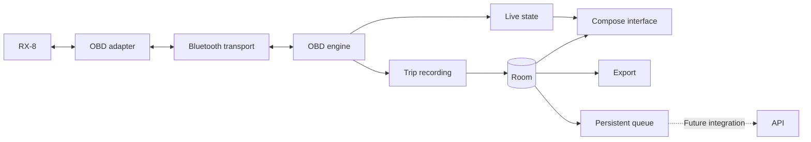

# Architecture

## Status

The app contains a deterministic simulator and provisional Bluetooth Classic/SPP transport with bounded in-app discovery.
The Bluetooth screen combines paired devices and nearby discoveries, handles scan and connection permissions separately, and opens a secure RFCOMM socket.
Device names and MAC addresses are shown locally so the user can identify the OBDII adapter reported in Car Scanner.
It sends no application bytes or ELM/OBD requests and keeps **Bluetooth connection** separate from **ECU communication: not checked**.

Both screens are foreground-only: simulation pauses when its tab is hidden, and leaving the Adapter tab or app closes the connection and requires manual reconnection.
The user reported the simulator app worked after testing on October 10, 2026 and confirmed the Samsung A53 runs Android 16.
The paired-only Bluetooth build failed to list the adapter, which the user finds by searching in Car Scanner with plain Bluetooth selected.
Discovery and secure SPP still require validation in this app; no ECU result has been reported.

The diagram and later storage, identity, recording, and synchronization sections describe the **target MVP architecture**.
Actual OBD queries, vehicle identity, saved trips, Room/DataStore storage, and API integration remain planned.
See [Development](development.md) for setup and current behavior.

Target: European-market 2004 RX-8 with 231 PS, Samsung A53 running Android 16, and iLC B0BDRHRR22 adapter.
Secure Classic/SPP is an initial implementation assumption; RX8-001 must establish physical compatibility.

## Components

Use Kotlin and Jetpack Compose for the interface, ViewModel/StateFlow for its state, and coroutines for asynchronous work.
Room stores structured data; DataStore stores settings.
Components can start as packages; there is no need to create a Gradle module for each component from day one.

## Transport and OBD engine

### Current discovery and transport

The Android transport is separate from Compose presentation and the synthetic telemetry source.
It lists bonded devices and performs a user-started, bounded Classic inquiry. Results are merged by MAC address, without filtering by adapter name.
Discovery stops before connecting, when cancelled, or when leaving the foreground. Scanning is unavailable during a connection.
It attempts secure RFCOMM using the standard Serial Port Profile service UUID; Android handles pairing when the selected device is not bonded.
It does not implement a BLE transport or fallback to an unverified connection method.

Connection attempts run away from the UI thread with a 15-second timeout for bonded devices or 45 seconds for unbonded devices to allow Android's pairing prompt.
Each discovery inquiry is limited to 15 seconds, after allowing up to two seconds to stop an existing inquiry.
Byte reads and writes are bounded and cancellable; closing the socket cancels blocked operations.
These byte operations prepare for RX8-004. The connection screen does not call them to send ELM initialization or ECU commands.
Android still performs the protocol handshakes needed to establish the Bluetooth connection.

No automatic reconnection, background service, or ECU heartbeat is implemented.
The user reconnects manually, and a connected socket does not establish adapter command compatibility or sensor availability.
This follows Android's [paired-device](https://developer.android.com/develop/connectivity/bluetooth/find-bluetooth-devices) and [RFCOMM client](https://developer.android.com/develop/connectivity/bluetooth/connect-bluetooth-devices) guidance.

### Planned OBD engine

RX8-004 will:

- Initialize the adapter and discover the protocol and capabilities.
- Serialize requests through a queue with timeouts and bounded retries.
- Reassemble fragments and preserve the source ECU when multiple modules respond.
- Distinguish adapter errors, missing responses, and unsupported parameters.
- Prioritize visible/selected sensors and adjust polling intervals to latency.
- Avoid repeatedly querying parameters reported as unsupported.

Do not commit to a per-sensor sampling rate before measuring it. Sequential readings are not simultaneous: each has its own timestamp.
The adapter's identification string alone does not prove its authenticity or all of its capabilities.

## Local model

| Entity | Contents |
| --- | --- |
| Vehicle | Stable UUID, optional VIN, provenance, and alias |
| Adapter | Connection information and observed capabilities |
| Capability | Parameters by vehicle, ECU, and profile |
| Session | Start, end, duration, status, and real/simulated origin |
| TelemetrySample | UUID, sequence, timestamps, metric, value, unit, source, and status |
| OutboxEntry | Pending work, attempts, next execution, and acknowledgments |

Samples are immutable. Sessions use the recording, completed, or interrupted states.
Each reading carries a UTC timestamp and monotonic elapsed time since the start; sequence determines ordering.
Values are normalized to canonical units and converted only for display.

A failed reading has a null value. The interface may show the last valid reading as stale without storing it again as a new measurement.
Distance integrated from speed is identified as an estimate and records intervals with missing data.

## Identity

Always create a vehicleId UUID when registering a car.
The VIN is optional, retrieved through mode 09 PID 02 or entered manually, with validation and provenance.

Adding a VIN does not change the identity or split the history.
A different VIN must not be silently assigned to the active profile: the user must select or create the corresponding vehicle.
The adapter's MAC address does not identify the car. Without a VIN, the user selects the profile when necessary.

After clearing app data or reinstalling, recovering the same UUIDs requires restoring a compatible backup/export.
Import/restore has not been implemented and is not guaranteed in the MVP; JSON retains the necessary information.

## Sessions and permissions

### Current connection permissions

On Android 12/API 31 and later, connecting requires `BLUETOOTH_CONNECT`, and discovery also requires `BLUETOOTH_SCAN`, through Nearby devices runtime prompts.
Scan access uses `neverForLocation`; the app does not derive physical location from scan results.
On API 26-30, legacy `BLUETOOTH` and `BLUETOOTH_ADMIN` apply, and discovery requires foreground fine-location permission and enabled location services.
Those legacy permissions are limited to API 30. Android 12+ does not request location permission. No GPS collection, advertising, or Internet permission is implemented.
Android can present pairing during connection. Bluetooth and permission settings remain available for recovery.
See Android's [Bluetooth permission guidance](https://developer.android.com/develop/connectivity/bluetooth/bt-permissions).

The connection closes when the Adapter tab is hidden or the app leaves the foreground. Returning requires a manual reconnect.
This is not screen-locked trip recording.

### Planned recording sessions

RX8-007 will add user-started recording with a `connectedDevice` foreground service, a notification, and a stop action.
Declare the permissions and service type required by the Android version/target when implementing that feature.

The MVP does not include GPS. WorkManager is reserved for future synchronization, not vehicle polling.
Recording with the screen locked will need explicit A53 testing; indefinite survival after process termination is not promised.
Record a gap when Bluetooth is lost; after restarting, recover persisted data and mark the unfinished session as interrupted.

## Future synchronization

Define a remote interface, versioned models, and a fake implementation solely for isolated tests.
The app used with real data keeps uploads disabled until an API and authentication are available.

Local writes and pending-work creation are atomic.
The queue references persisted samples without duplicating the entire history.
A future worker sends batches, observes connectivity requirements, and confirms only records that receive an acknowledgment (ACK).
A server simulator must never mark the user's real data as uploaded.
See [the contract](api-contract.md) for details.

## Retention and export

Keep trips until explicitly deleted, show storage usage, and warn before storage runs out.
If data cannot be saved, stop recording in a controlled way and display the error.
When deleting records pending upload, explain which data will be lost and remove their queued work.

Export versioned JSON with IDs, units, and statuses; use CSV for analysis.
Do not commit real databases or private exports.
Define exclusions/encryption for Android backups before distribution.

## Validation

Parser tests with complete, fragmented, multi-ECU, and malformed responses.
Tests for persistence, migrations, identity, unexpected termination, the queue, and retries.
Interface tests with a clearly identified simulator.
Real-vehicle validation for compatibility, sampling rate, reconnection, and recording with the screen locked.

## References

- [Android architecture](https://developer.android.com/topic/architecture/recommendations).
- [Bluetooth Classic](https://developer.android.com/develop/connectivity/bluetooth/connect-bluetooth-devices).
- [Bluetooth permissions](https://developer.android.com/develop/connectivity/bluetooth/bt-permissions).
- [Foreground services](https://developer.android.com/develop/background-work/services/fgs/service-types#connected-device).
- [Offline-first operation](https://developer.android.com/topic/architecture/data-layer/offline-first).
