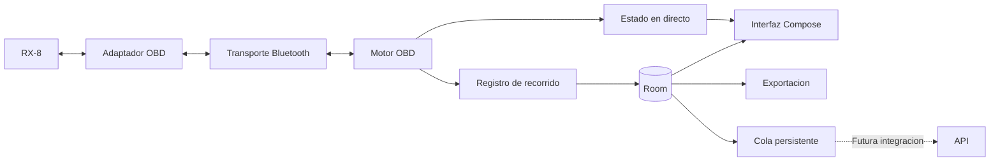

# Arquitectura

## Estado

Diseño inicial; la app y el servidor no están implementados.
Objetivo: RX-8 europeo 2004 de 231 CV, Samsung A53 y adaptador iLC B0BDRHRR22.
La compatibilidad exacta se confirma en RX8-001.

## Componentes

Kotlin y Jetpack Compose para la interfaz, ViewModel/StateFlow para su estado y coroutines para trabajo asíncrono.
Room guarda datos estructurados; DataStore conserva ajustes.
Los componentes pueden empezar como paquetes; no es necesario crear un módulo Gradle por cada componente desde el primer día.

## Transporte y motor OBD

Bluetooth clásico RFCOMM/SPP es la hipótesis de partida para este adaptador; se validará antes de fijarlo.
BLE requiere otra implementación. La interfaz de transporte expone conexión, bytes y cancelación, sin interpretar sensores.

El motor OBD:

- Inicializa el adaptador y detecta protocolo y capacidades.
- Serializa las peticiones mediante una cola con tiempos de espera y reintentos limitados.
- Reconstruye fragmentos y conserva el origen ECU cuando responden varios módulos.
- Diferencia errores del adaptador, falta de respuesta y parámetros no compatibles.
- Prioriza sensores visibles/seleccionados y ajusta cadencia según latencia.
- Evita consultas repetidas a parámetros declarados no compatibles.

No se fija una frecuencia por sensor hasta medirla. Las lecturas sucesivas no son simultáneas: cada una tiene su instante.
La identificación textual del adaptador no acredita por sí sola la autenticidad ni todas sus capacidades.

## Modelo local

| Entidad | Contenido |
| --- | --- |
| Vehicle | UUID estable, VIN opcional, procedencia y alias |
| Adapter | Datos de conexión y capacidades observadas |
| Capability | Parámetros por vehículo, ECU y perfil |
| Session | Inicio, cierre, duración, estado y origen real/simulado |
| TelemetrySample | UUID, secuencia, tiempos, métrica, valor, unidad, origen y estado |
| OutboxEntry | Trabajo pendiente, intentos, próxima ejecución y confirmaciones |

Las muestras son inmutables. La sesión conserva estados recording, completed o interrupted.
Cada lectura lleva fecha UTC y tiempo monotónico desde el inicio; se ordena por secuencia.
Los valores se normalizan a unidades canónicas y se convierten solo para presentación.

Una lectura errónea tiene valor nulo. La interfaz puede mostrar el último dato válido como antiguo, sin guardarlo otra vez como nueva medición.
La distancia integrada desde velocidad se identifica como estimación y deja constancia de los intervalos sin datos.

## Identidad

Crear siempre un vehicleId UUID al dar de alta el coche.
El VIN es opcional, obtenido mediante modo 09 PID 02 o introducido manualmente, con validación y procedencia.

Añadir el VIN no cambia la identidad ni divide el historial.
Un VIN diferente no se asigna silenciosamente al perfil activo: requiere seleccionar o crear el vehículo correspondiente.
La MAC del adaptador no identifica al coche. Sin VIN, el usuario selecciona el perfil cuando sea necesario.

Tras borrar datos o reinstalar, recuperar los mismos UUID requiere restauración de una copia/exportación compatible.
La importación/restauración no está implementada ni se garantiza en el MVP; se conserva la información necesaria en JSON.

## Sesiones y permisos

Una grabación iniciada por el usuario utiliza un servicio en primer plano de tipo connectedDevice con notificación y acción de detener.
Se solicita BLUETOOTH_CONNECT en Android 12+ y BLUETOOTH_SCAN cuando haya descubrimiento.
El servicio declara los permisos y tipo exigidos por la versión/target de Android.
Se tratan por separado los requisitos de versiones antiguas.

No hay GPS en el MVP. WorkManager se reserva para futura sincronización, no para muestrear el coche.

Se probará la continuidad con pantalla bloqueada en el A53. No se promete supervivencia ilimitada a terminación del proceso.
Ante pérdida de Bluetooth se registra el hueco; al reiniciar se recuperan datos persistidos y se marca la sesión inconclusa como interrumpida.

## Sincronización futura

Define una interfaz remota, modelos versionados y una implementación falsa solo para pruebas aisladas.
La aplicación de uso real mantiene los envíos desactivados hasta disponer de API y autenticación.

La escritura local y la creación del trabajo pendiente son atómicas.
La cola referencia muestras persistidas, sin duplicar todo el historial.
Un futuro worker envía lotes, respeta conectividad y confirma únicamente registros con ACK.
Un simulador de servidor nunca marca enviados los datos reales del usuario.
Detalles en [el contrato](api-contract.md).

## Retención y exportación

Conservar recorridos hasta su eliminación explícita, mostrar espacio usado y avisar antes de agotarlo.
Si no se puede guardar, detener la grabación de forma controlada y mostrar el error.
Al eliminar registros pendientes de envío, indicar qué datos se pierden y retirar sus trabajos de cola.

Exportar JSON versionado con IDs, unidades y estados; CSV para análisis.
No versionar bases de datos reales ni exportaciones privadas.
Definir exclusiones/cifrado de las copias de seguridad Android antes de distribución.

## Validación

Pruebas del parser con respuestas completas, fragmentadas, múltiples ECU y malformadas.
Pruebas de persistencia, migraciones, identidad, cierres inesperados, cola y reintentos.
Pruebas de interfaz con simulador claramente identificado.
Validación con coche real para compatibilidad, cadencia, reconexión y pantalla bloqueada.

## Referencias

- [Arquitectura Android](https://developer.android.com/topic/architecture/recommendations).
- [Bluetooth clásico](https://developer.android.com/develop/connectivity/bluetooth/connect-bluetooth-devices).
- [Permisos Bluetooth](https://developer.android.com/develop/connectivity/bluetooth/bt-permissions).
- [Servicios en primer plano](https://developer.android.com/develop/background-work/services/fgs/service-types#connected-device).
- [Funcionamiento sin conexión](https://developer.android.com/topic/architecture/data-layer/offline-first).
